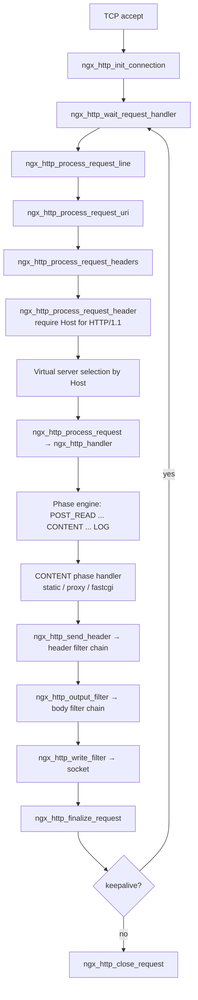
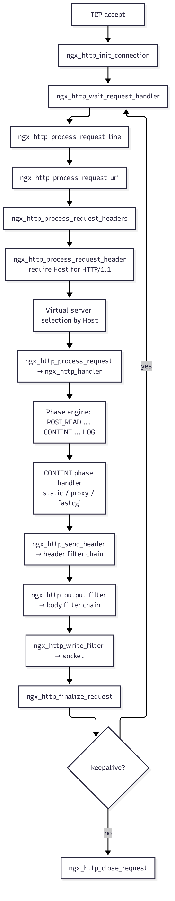
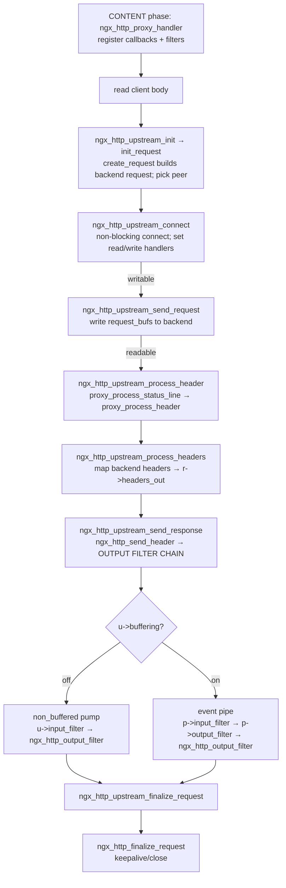
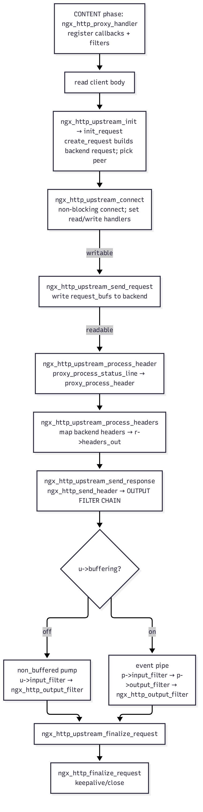
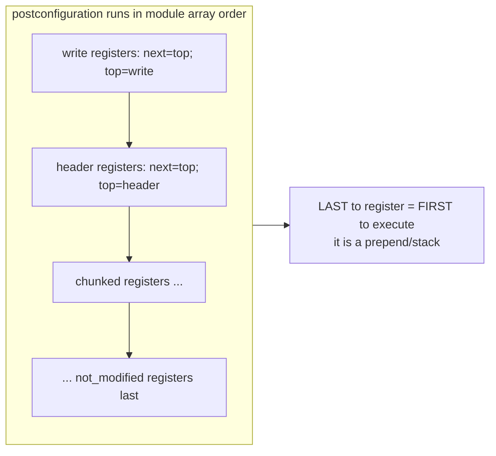
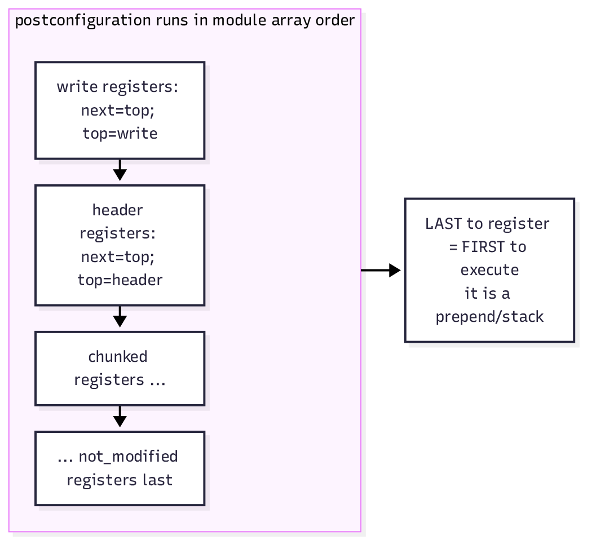
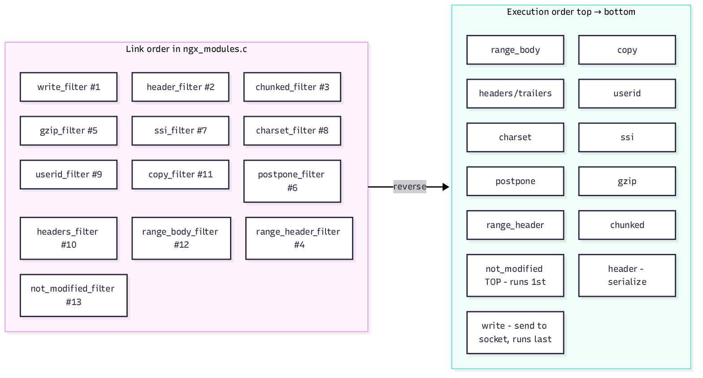

# How nginx Handles HTTP/1.1 End-to-End

This document explains, with links to the actual source, how nginx processes an
HTTP/1.1 request from accept to close, how the **proxy upstream** path works in
the CONTENT phase, and how the **output filter chain** is registered and ordered.

All source links point at the `master` branch of
[`vinaykumar-1591/nginx`](https://github.com/vinaykumar-1591/nginx).

---

## 1. The big picture

nginx is an **event-driven, non-blocking** server. There are no per-request
threads — a small number of worker processes each run an event loop
(epoll/kqueue) and drive every connection through a sequence of **callback
handlers**. An HTTP/1.1 request is a state machine where each state installs the
next read/write event handler and returns to the loop.

Core files:

- Request engine: [`src/http/ngx_http_request.c`](https://github.com/vinaykumar-1591/nginx/blob/master/src/http/ngx_http_request.c)
- Byte-level parser: [`src/http/ngx_http_parse.c`](https://github.com/vinaykumar-1591/nginx/blob/master/src/http/ngx_http_parse.c)
- Phase engine / core module: [`src/http/ngx_http_core_module.c`](https://github.com/vinaykumar-1591/nginx/blob/master/src/http/ngx_http_core_module.c)

---

## 2. Request lifecycle (accept → close)

| Stage | Function | Source |
|---|---|---|
| Listen socket wiring | `ngx_http_init_listening` / `ngx_http_add_listening` | [ngx_http.c#L1796](https://github.com/vinaykumar-1591/nginx/blob/master/src/http/ngx_http.c#L1796) |
| Accept → HTTP entry | `ngx_http_init_connection` | [ngx_http_request.c#L211](https://github.com/vinaykumar-1591/nginx/blob/master/src/http/ngx_http_request.c#L211) |
| Wait for first bytes | `ngx_http_wait_request_handler` | [ngx_http_request.c#L377](https://github.com/vinaykumar-1591/nginx/blob/master/src/http/ngx_http_request.c#L377) |
| Parse request line | `ngx_http_process_request_line` | [ngx_http_request.c#L1115](https://github.com/vinaykumar-1591/nginx/blob/master/src/http/ngx_http_request.c#L1115) |
| Normalize URI | `ngx_http_process_request_uri` | [ngx_http_request.c#L1280](https://github.com/vinaykumar-1591/nginx/blob/master/src/http/ngx_http_request.c#L1280) |
| Parse headers | `ngx_http_process_request_headers` | [ngx_http_request.c#L1401](https://github.com/vinaykumar-1591/nginx/blob/master/src/http/ngx_http_request.c#L1401) |
| Validate headers (require `Host`) | `ngx_http_process_request_header` | [ngx_http_request.c#L2024](https://github.com/vinaykumar-1591/nginx/blob/master/src/http/ngx_http_request.c#L2024) |
| Begin processing | `ngx_http_process_request` | [ngx_http_request.c#L2126](https://github.com/vinaykumar-1591/nginx/blob/master/src/http/ngx_http_request.c#L2126) |
| Run phase engine | `ngx_http_handler` | [ngx_http_core_module.c#L848](https://github.com/vinaykumar-1591/nginx/blob/master/src/http/ngx_http_core_module.c#L848) |
| Read request body | `ngx_http_read_client_request_body` | [ngx_http_request_body.c#L32](https://github.com/vinaykumar-1591/nginx/blob/master/src/http/ngx_http_request_body.c#L32) |
| Discard request body | `ngx_http_discard_request_body` | [ngx_http_request_body.c#L632](https://github.com/vinaykumar-1591/nginx/blob/master/src/http/ngx_http_request_body.c#L632) |
| Send headers | `ngx_http_send_header` | [ngx_http_core_module.c#L1904](https://github.com/vinaykumar-1591/nginx/blob/master/src/http/ngx_http_core_module.c#L1904) |
| Send body | `ngx_http_output_filter` | [ngx_http_core_module.c#L1957](https://github.com/vinaykumar-1591/nginx/blob/master/src/http/ngx_http_core_module.c#L1957) |
| Finalize request | `ngx_http_finalize_request` | [ngx_http_request.c#L2743](https://github.com/vinaykumar-1591/nginx/blob/master/src/http/ngx_http_request.c#L2743) |
| Keepalive (persistent conn) | `ngx_http_set_keepalive` | [ngx_http_request.c#L3352](https://github.com/vinaykumar-1591/nginx/blob/master/src/http/ngx_http_request.c#L3352) |
| Keepalive wait handler | `ngx_http_keepalive_handler` | [ngx_http_request.c#L3580](https://github.com/vinaykumar-1591/nginx/blob/master/src/http/ngx_http_request.c#L3580) |
| Close request | `ngx_http_close_request` | [ngx_http_request.c#L3948](https://github.com/vinaykumar-1591/nginx/blob/master/src/http/ngx_http_request.c#L3948) |

### One-line mental model

```
ngx_http_init_connection → wait_request_handler → process_request_line
  → process_request_headers → process_request → ngx_http_handler (phase engine → CONTENT)
  → send_header / output_filter → write_filter → finalize_request
  → set_keepalive (loop) or close
```

### Request lifecycle diagram



> Pre-rendered image (for Confluence without a Mermaid plugin):
> 
> — SVG: [diagrams/01-request-lifecycle.svg](diagrams/01-request-lifecycle.svg)

### The 11 processing phases

Defined in [`ngx_http_core_module.h#L111`](https://github.com/vinaykumar-1591/nginx/blob/master/src/http/ngx_http_core_module.h#L111):

| Phase | Purpose |
|---|---|
| `POST_READ` | earliest hook (e.g. realip) |
| `SERVER_REWRITE` | server-level rewrites |
| `FIND_CONFIG` | match the `location {}` for the URI |
| `REWRITE` / `POST_REWRITE` | location rewrites + rewrite-loop handling |
| `PREACCESS` | limit_req, limit_conn |
| `ACCESS` / `POST_ACCESS` | allow/deny, auth_basic, auth_request |
| `PRECONTENT` | try_files, mirror, internal redirects |
| `CONTENT` | generate the response (static, proxy, fastcgi, …) |
| `LOG` | access logging |

### HTTP/1.1-specific behaviors

- **Mandatory `Host` header** — enforced in `ngx_http_process_request_header`; enables name-based virtual hosts.
- **Persistent connections by default** — keepalive path, disabled only on `Connection: close` or limits.
- **Chunked transfer-encoding** — request side in `ngx_http_parse_chunked`, response side in the chunked body filter.
- **`Expect: 100-continue`** — interim response handled in the request-body reader.
- **Pipelining** — leftover buffered bytes processed as the next request.
- **Incremental, resumable parsing** — every parser returns `NGX_AGAIN` and resumes, so partial reads never block a worker.

---

## 3. Proxy upstream path (CONTENT phase)

When a request matches a `location` with `proxy_pass`, the CONTENT handler is
[`ngx_http_proxy_handler`](https://github.com/vinaykumar-1591/nginx/blob/master/src/http/modules/ngx_http_proxy_module.c#L876).
It then runs a generic **upstream state machine**
([`src/http/ngx_http_upstream.c`](https://github.com/vinaykumar-1591/nginx/blob/master/src/http/ngx_http_upstream.c))
shared by proxy, fastcgi, scgi, uwsgi, grpc, and memcached. The protocol module
supplies only **callbacks**; the upstream engine drives the event loop.

### Step-by-step

| Step | Function | Source |
|---|---|---|
| Handler setup, register callbacks | `ngx_http_proxy_handler` | [proxy#L876](https://github.com/vinaykumar-1591/nginx/blob/master/src/http/modules/ngx_http_proxy_module.c#L876) |
| Build backend request | `ngx_http_proxy_create_request` | [proxy#L1184](https://github.com/vinaykumar-1591/nginx/blob/master/src/http/modules/ngx_http_proxy_module.c#L1184) |
| Init upstream | `ngx_http_upstream_init` | [upstream#L549](https://github.com/vinaykumar-1591/nginx/blob/master/src/http/ngx_http_upstream.c#L549) |
| Pick peer, start | `ngx_http_upstream_init_request` | [upstream#L593](https://github.com/vinaykumar-1591/nginx/blob/master/src/http/ngx_http_upstream.c#L593) |
| Non-blocking connect | `ngx_http_upstream_connect` | [upstream#L1579](https://github.com/vinaykumar-1591/nginx/blob/master/src/http/ngx_http_upstream.c#L1579) |
| Send request to backend | `ngx_http_upstream_send_request` | [upstream#L2170](https://github.com/vinaykumar-1591/nginx/blob/master/src/http/ngx_http_upstream.c#L2170) |
| Read + parse status/headers | `ngx_http_upstream_process_header` | [upstream#L2467](https://github.com/vinaykumar-1591/nginx/blob/master/src/http/ngx_http_upstream.c#L2467) |
| Parse status line (proxy) | `ngx_http_proxy_process_status_line` | [proxy#L1802](https://github.com/vinaykumar-1591/nginx/blob/master/src/http/modules/ngx_http_proxy_module.c#L1802) |
| Parse headers (proxy) | `ngx_http_proxy_process_header` | [proxy#L1889](https://github.com/vinaykumar-1591/nginx/blob/master/src/http/modules/ngx_http_proxy_module.c#L1889) |
| Map backend → `r->headers_out` | `ngx_http_upstream_process_headers` | [upstream#L3091](https://github.com/vinaykumar-1591/nginx/blob/master/src/http/ngx_http_upstream.c#L3091) |
| Send response downstream (branch) | `ngx_http_upstream_send_response` | [upstream#L3289](https://github.com/vinaykumar-1591/nginx/blob/master/src/http/ngx_http_upstream.c#L3289) |
| Buffered forwarding (event pipe) | `ngx_http_upstream_process_upstream` | [upstream#L4365](https://github.com/vinaykumar-1591/nginx/blob/master/src/http/ngx_http_upstream.c#L4365) |
| Unbuffered forwarding | `ngx_http_upstream_process_non_buffered_request` | [upstream#L3956](https://github.com/vinaykumar-1591/nginx/blob/master/src/http/ngx_http_upstream.c#L3956) |
| Finalize | `ngx_http_upstream_finalize_request` | [upstream#L4785](https://github.com/vinaykumar-1591/nginx/blob/master/src/http/ngx_http_upstream.c#L4785) |

### Callback wiring in `ngx_http_proxy_handler`

Registered callbacks the generic engine calls later:

- `u->create_request = ngx_http_proxy_create_request`
- `u->process_header = ngx_http_proxy_process_status_line` (then switches to `ngx_http_proxy_process_header`)
- `u->reinit_request`, `u->abort_request`, `u->finalize_request`
- `u->buffering = plcf->upstream.buffering` — chooses the two response-forwarding modes
- Buffered filters: `u->pipe->input_filter = ngx_http_proxy_copy_filter`
- Unbuffered filters: `u->input_filter_init = ngx_http_proxy_input_filter_init`, `u->input_filter = ngx_http_proxy_non_buffered_copy_filter`
- Finally: `ngx_http_read_client_request_body(r, ngx_http_upstream_init)`

### Two forwarding modes

`ngx_http_upstream_send_response` first calls `ngx_http_send_header(r)` — **this is
where the backend response enters nginx's own output filter chain** — then splits on
`u->buffering`:

- **Unbuffered (`proxy_buffering off`):** read-upstream → write-downstream pump via
  `ngx_http_upstream_process_non_buffered_*`. Uses `u->input_filter`.
- **Buffered (default):** sets up the **event pipe** `u->pipe` with
  `input_filter = ngx_http_proxy_copy_filter` (or `..._chunked_filter`) and
  `output_filter = ngx_http_upstream_output_filter`. A fast backend can read ahead into
  `proxy_buffers` and spill to a temp file while a slow client drains at its own pace.

### Proxy path diagram



> Pre-rendered image (for Confluence without a Mermaid plugin):
> 
> — SVG: [diagrams/02-proxy-upstream.svg](diagrams/02-proxy-upstream.svg)

---

## 4. Filter chain registration order

### Mechanism: prepend-to-head

Two global function pointers declared in
[`ngx_http.c#L74`](https://github.com/vinaykumar-1591/nginx/blob/master/src/http/ngx_http.c#L74):

```c
ngx_http_output_header_filter_pt  ngx_http_top_header_filter;
ngx_http_output_body_filter_pt    ngx_http_top_body_filter;
```

Each filter module, in its `postconfiguration` step, prepends itself — saving the
current head into a static `next` pointer, then becoming the new head (example from
the chunked module,
[`ngx_http_chunked_filter_module.c#L336`](https://github.com/vinaykumar-1591/nginx/blob/master/src/http/modules/ngx_http_chunked_filter_module.c#L336)):

```c
ngx_http_next_header_filter = ngx_http_top_header_filter;   /* save current head  */
ngx_http_top_header_filter  = ngx_http_chunked_header_filter; /* become new head   */
```

Because `postconfiguration` runs in **module array order** and each module
**prepends**, the **last module to register ends up first in the execution chain**.
So **execution order = reverse of link order** in
[`objs/ngx_modules.c`](https://github.com/vinaykumar-1591/nginx/blob/master/objs/ngx_modules.c).



> Pre-rendered image (for Confluence without a Mermaid plugin):
> 
> — SVG: [diagrams/03-filter-registration.svg](diagrams/03-filter-registration.svg)

### Link order → execution order (the flip)


> Pre-rendered image (for Confluence without a Mermaid plugin):
> 
> — SVG: [diagrams/04-filter-link-flip.svg](diagrams/04-filter-link-flip.svg)

The link order above is taken directly from
[`objs/ngx_modules.c`](https://github.com/vinaykumar-1591/nginx/blob/master/objs/ngx_modules.c)
(head of list = registered first = runs last).

### Resulting runtime chains (top → bottom)

**Header chain** — entered via
[`ngx_http_send_header`](https://github.com/vinaykumar-1591/nginx/blob/master/src/http/ngx_http_core_module.c#L1904)
→ `ngx_http_top_header_filter`:

```
not_modified
headers        add_header / expires
userid         Set-Cookie for userid
charset        Content-Type charset
ssi            unset Content-Length for SSI
gzip           decide compression, set Content-Encoding
range_header   Accept-Ranges / 206 Content-Range
chunked        choose Transfer-Encoding: chunked vs Content-Length
header     ◄── ngx_http_header_filter: SERIALIZES status line + headers to wire
write          flush header bytes to socket
```

**Body chain** — entered via
[`ngx_http_output_filter`](https://github.com/vinaykumar-1591/nginx/blob/master/src/http/ngx_http_core_module.c#L1957)
→ `ngx_http_top_body_filter`:

```
not_modified / range_body   trim to requested byte range
copy       ◄── ngx_http_copy_filter: read files/bufs into memory (sendfile/AIO)
headers        trailers
charset        recode charset
ssi            process <!--# ... --> includes
postpone   ◄── order subrequest output correctly
gzip           compress buffers
chunked    ◄── ngx_http_chunked_body_filter: wrap bufs in hex chunk framing
write      ◄── ngx_http_write_filter: ACTUAL send() to the client socket
```

### Key invariants

| Fact | Why it holds |
|---|---|
| `write_filter` is always the **terminal** body sink | It registers **first** ([write_filter_module.c#L368](https://github.com/vinaykumar-1591/nginx/blob/master/src/http/ngx_http_write_filter_module.c#L368)), so it sinks to the bottom. |
| `header_filter` sits just above `write` | Registers second; serializes `r->headers_out` → `HTTP/1.1 ...\r\n` bytes ([header_filter_module.c#L161](https://github.com/vinaykumar-1591/nginx/blob/master/src/http/ngx_http_header_filter_module.c#L161)). |
| Order is **not** configurable at runtime | Fixed at compile time by module link order in `ngx_modules.c` (driven by `auto/modules`). |
| Third-party filter modules run near the **top** | They are linked after the built-ins, so they register last and execute first. |

Registration idiom appears in each module's `postconfiguration`, e.g.:
[chunked#L336](https://github.com/vinaykumar-1591/nginx/blob/master/src/http/modules/ngx_http_chunked_filter_module.c#L336),
[copy#L428](https://github.com/vinaykumar-1591/nginx/blob/master/src/http/ngx_http_copy_filter_module.c#L428),
[gzip#L1130](https://github.com/vinaykumar-1591/nginx/blob/master/src/http/modules/ngx_http_gzip_filter_module.c#L1130),
[postpone#L255](https://github.com/vinaykumar-1591/nginx/blob/master/src/http/ngx_http_postpone_filter_module.c#L255).

---

## 5. Source reference index

| Area | File |
|---|---|
| Request engine | [ngx_http_request.c](https://github.com/vinaykumar-1591/nginx/blob/master/src/http/ngx_http_request.c) |
| Parser (request line, headers, chunked) | [ngx_http_parse.c](https://github.com/vinaykumar-1591/nginx/blob/master/src/http/ngx_http_parse.c) |
| Phase engine / core | [ngx_http_core_module.c](https://github.com/vinaykumar-1591/nginx/blob/master/src/http/ngx_http_core_module.c) |
| Request body | [ngx_http_request_body.c](https://github.com/vinaykumar-1591/nginx/blob/master/src/http/ngx_http_request_body.c) |
| Generic upstream engine | [ngx_http_upstream.c](https://github.com/vinaykumar-1591/nginx/blob/master/src/http/ngx_http_upstream.c) |
| Proxy module | [ngx_http_proxy_module.c](https://github.com/vinaykumar-1591/nginx/blob/master/src/http/modules/ngx_http_proxy_module.c) |
| Header filter (serializer) | [ngx_http_header_filter_module.c](https://github.com/vinaykumar-1591/nginx/blob/master/src/http/ngx_http_header_filter_module.c) |
| Write filter (socket sink) | [ngx_http_write_filter_module.c](https://github.com/vinaykumar-1591/nginx/blob/master/src/http/ngx_http_write_filter_module.c) |
| Chunked filter | [ngx_http_chunked_filter_module.c](https://github.com/vinaykumar-1591/nginx/blob/master/src/http/modules/ngx_http_chunked_filter_module.c) |
| Copy filter | [ngx_http_copy_filter_module.c](https://github.com/vinaykumar-1591/nginx/blob/master/src/http/ngx_http_copy_filter_module.c) |
| Postpone filter | [ngx_http_postpone_filter_module.c](https://github.com/vinaykumar-1591/nginx/blob/master/src/http/ngx_http_postpone_filter_module.c) |
| Compiled module order | [objs/ngx_modules.c](https://github.com/vinaykumar-1591/nginx/blob/master/objs/ngx_modules.c) |

> Note: line numbers refer to the `master` branch of
> [`vinaykumar-1591/nginx`](https://github.com/vinaykumar-1591/nginx) at the time of
> writing and may drift as the code changes.
