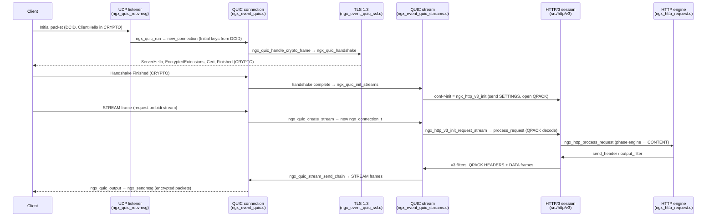
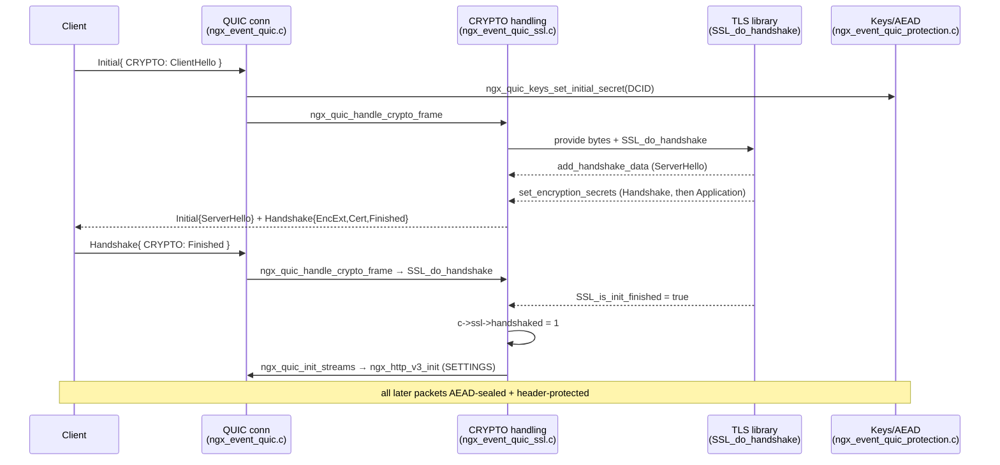
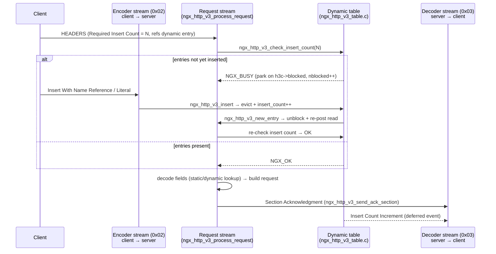
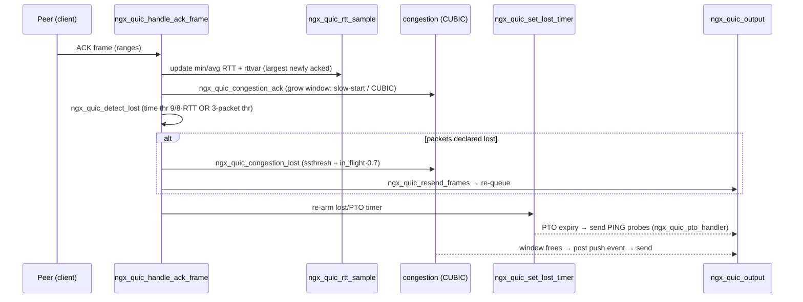

# How nginx Handles HTTP/3 (QUIC) End-to-End

This document explains, with links to the actual source, how nginx serves an
**HTTP/3** request from the first UDP datagram to connection close. HTTP/3 runs
over **QUIC**, which is itself layered on **UDP**, so the story has more layers
than HTTP/1.1 — but the top of the stack reuses the exact same request engine and
output filter chain described in
[How nginx Handles HTTP/1.1 End-to-End](nginx-http11-e2e.md).

All source links point at the `master` branch of
[`vinaykumar-1591/nginx`](https://github.com/vinaykumar-1591/nginx).

---

## 1. The big picture — a layered stack over UDP

Where HTTP/1.1 and HTTP/2 ride a single **TCP** connection, HTTP/3 rides **QUIC**
over **UDP**. nginx mirrors that with clean layering, and each layer is a set of
event-driven callback handlers (no threads per request):

```
UDP datagram            src/event/quic/ngx_event_quic_udp.c
  → QUIC connection      packets · TLS crypto · frames · ACK/recovery
       src/event/quic/ngx_event_quic*.c
     → QUIC stream        one ngx_connection_t per stream
          src/event/quic/ngx_event_quic_streams.c
        → HTTP/3 session   SETTINGS · QPACK · control/request streams
             src/http/v3/*
           → generic HTTP request engine (shared with HTTP/1.1 and HTTP/2)
                src/http/ngx_http_request.c
```

The pivotal design idea: **each QUIC stream is wrapped in its own
`ngx_connection_t`** whose `recv`/`send`/`send_chain` read and write *stream data*
rather than a socket. That lets the existing HTTP request machinery (phase engine,
filters, proxy, upstreams) run almost unchanged on top of a stream — exactly as it
runs on a TCP socket.

Core files:

- UDP ingress: [`src/event/quic/ngx_event_quic_udp.c`](https://github.com/vinaykumar-1591/nginx/blob/master/src/event/quic/ngx_event_quic_udp.c)
- QUIC connection engine: [`src/event/quic/ngx_event_quic.c`](https://github.com/vinaykumar-1591/nginx/blob/master/src/event/quic/ngx_event_quic.c)
- QUIC streams: [`src/event/quic/ngx_event_quic_streams.c`](https://github.com/vinaykumar-1591/nginx/blob/master/src/event/quic/ngx_event_quic_streams.c)
- TLS/QUIC handshake: [`src/event/quic/ngx_event_quic_ssl.c`](https://github.com/vinaykumar-1591/nginx/blob/master/src/event/quic/ngx_event_quic_ssl.c)
- Packet protection (AEAD/keys): [`src/event/quic/ngx_event_quic_protection.c`](https://github.com/vinaykumar-1591/nginx/blob/master/src/event/quic/ngx_event_quic_protection.c)
- HTTP/3 request stream: [`src/http/v3/ngx_http_v3_request.c`](https://github.com/vinaykumar-1591/nginx/blob/master/src/http/v3/ngx_http_v3_request.c)
- HTTP/3 output filters: [`src/http/v3/ngx_http_v3_filter_module.c`](https://github.com/vinaykumar-1591/nginx/blob/master/src/http/v3/ngx_http_v3_filter_module.c)

---

## 2. Connection & request lifecycle (datagram → close)

| Stage | Function | Source |
|---|---|---|
| Listen socket wiring (`listen ... quic`) | `ls->handler = ngx_http_init_connection` | [ngx_http.c#L1882](https://github.com/vinaykumar-1591/nginx/blob/master/src/http/ngx_http.c#L1882) |
| UDP datagram read | `ngx_quic_recvmsg` | [ngx_event_quic_udp.c#L20](https://github.com/vinaykumar-1591/nginx/blob/master/src/event/quic/ngx_event_quic_udp.c#L20) |
| Match existing conn by DCID | `ngx_quic_lookup_connection` | [ngx_event_quic_udp.c#L386](https://github.com/vinaykumar-1591/nginx/blob/master/src/event/quic/ngx_event_quic_udp.c#L386) |
| HTTP entry (routes QUIC) | `ngx_http_init_connection` | [ngx_http_request.c#L333](https://github.com/vinaykumar-1591/nginx/blob/master/src/http/ngx_http_request.c#L333) |
| QUIC/HTTP-3 bridge (first datagram) | `ngx_http_v3_init_stream` | [ngx_http_v3_request.c#L59](https://github.com/vinaykumar-1591/nginx/blob/master/src/http/v3/ngx_http_v3_request.c#L59) |
| Create QUIC connection state | `ngx_quic_run` → `ngx_quic_new_connection` | [ngx_event_quic.c#L201](https://github.com/vinaykumar-1591/nginx/blob/master/src/event/quic/ngx_event_quic.c#L201) |
| Steady-state datagram handler | `ngx_quic_input_handler` | [ngx_event_quic.c#L406](https://github.com/vinaykumar-1591/nginx/blob/master/src/event/quic/ngx_event_quic.c#L406) |
| Decrypt packet, dispatch frames | `ngx_quic_handle_payload` / `ngx_quic_handle_frames` | [ngx_event_quic.c#L959](https://github.com/vinaykumar-1591/nginx/blob/master/src/event/quic/ngx_event_quic.c#L959) |
| TLS handshake over CRYPTO frames | `ngx_quic_handle_crypto_frame` → `ngx_quic_handshake` | [ngx_event_quic_ssl.c#L627](https://github.com/vinaykumar-1591/nginx/blob/master/src/event/quic/ngx_event_quic_ssl.c#L627) |
| Handshake done → open app streams | `ngx_quic_init_streams` → `conf->init` | [ngx_event_quic_streams.c#L579](https://github.com/vinaykumar-1591/nginx/blob/master/src/event/quic/ngx_event_quic_streams.c#L579) |
| HTTP/3 session + SETTINGS | `ngx_http_v3_init` | [ngx_http_v3_request.c#L101](https://github.com/vinaykumar-1591/nginx/blob/master/src/http/v3/ngx_http_v3_request.c#L101) |
| New stream → its own connection | `ngx_quic_create_stream` | [ngx_event_quic_streams.c#L650](https://github.com/vinaykumar-1591/nginx/blob/master/src/event/quic/ngx_event_quic_streams.c#L650) |
| Dispatch stream to listener handler | `ngx_quic_init_stream_handler` | [ngx_event_quic_streams.c#L555](https://github.com/vinaykumar-1591/nginx/blob/master/src/event/quic/ngx_event_quic_streams.c#L555) |
| Request (bidi) stream setup | `ngx_http_v3_init_request_stream` | [ngx_http_v3_request.c#L180](https://github.com/vinaykumar-1591/nginx/blob/master/src/http/v3/ngx_http_v3_request.c#L180) |
| Wait for first request bytes | `ngx_http_v3_wait_request_handler` | [ngx_http_v3_request.c#L275](https://github.com/vinaykumar-1591/nginx/blob/master/src/http/v3/ngx_http_v3_request.c#L275) |
| Parse QPACK HEADERS, build request | `ngx_http_v3_process_request` | [ngx_http_v3_request.c#L463](https://github.com/vinaykumar-1591/nginx/blob/master/src/http/v3/ngx_http_v3_request.c#L463) |
| Finalize request headers | `ngx_http_v3_process_request_header` | [ngx_http_v3_request.c#L1013](https://github.com/vinaykumar-1591/nginx/blob/master/src/http/v3/ngx_http_v3_request.c#L1013) |
| Enter the shared engine | `ngx_http_process_request` → `ngx_http_handler` | [ngx_http_request.c](https://github.com/vinaykumar-1591/nginx/blob/master/src/http/ngx_http_request.c) |
| Encode response headers (QPACK) | `ngx_http_v3_header_filter` | [ngx_http_v3_filter_module.c#L85](https://github.com/vinaykumar-1591/nginx/blob/master/src/http/v3/ngx_http_v3_filter_module.c#L85) |
| Wrap body in DATA frames | `ngx_http_v3_body_filter` | [ngx_http_v3_filter_module.c#L739](https://github.com/vinaykumar-1591/nginx/blob/master/src/http/v3/ngx_http_v3_filter_module.c#L739) |
| Write stream bytes → STREAM frames | `ngx_quic_stream_send_chain` → `ngx_quic_stream_flush` | [ngx_event_quic_streams.c#L952](https://github.com/vinaykumar-1591/nginx/blob/master/src/event/quic/ngx_event_quic_streams.c#L952) |
| Packetize, encrypt, coalesce | `ngx_quic_output` | [ngx_event_quic_output.c#L71](https://github.com/vinaykumar-1591/nginx/blob/master/src/event/quic/ngx_event_quic_output.c#L71) |
| Send on UDP socket | `ngx_quic_send` → `ngx_sendmsg` | [ngx_event_quic_output.c#L719](https://github.com/vinaykumar-1591/nginx/blob/master/src/event/quic/ngx_event_quic_output.c#L719) |
| Graceful shutdown (GOAWAY) | `ngx_http_v3_shutdown` | [ngx_http_v3_request.c#L152](https://github.com/vinaykumar-1591/nginx/blob/master/src/http/v3/ngx_http_v3_request.c#L152) |
| Connection close (CONNECTION_CLOSE) | `ngx_quic_finalize_connection` → `ngx_quic_close_connection` | [ngx_event_quic.c#L470](https://github.com/vinaykumar-1591/nginx/blob/master/src/event/quic/ngx_event_quic.c#L470) |

### One-line mental model

```
ngx_quic_recvmsg → ngx_http_v3_init_stream → ngx_quic_run (connection + TLS keys)
  → ngx_quic_handshake (TLS 1.3 in CRYPTO frames) → ngx_quic_init_streams → ngx_http_v3_init (SETTINGS)
  → per request stream: ngx_http_v3_process_request (QPACK) → ngx_http_process_request (phase engine)
  → v3 header/body filters (QPACK + DATA) → ngx_quic_stream_send_chain → ngx_quic_output → ngx_sendmsg
  → GOAWAY / CONNECTION_CLOSE
```

### Lifecycle sequence diagram



---

## 3. Ingress — UDP datagram → QUIC connection

The `listen ... quic` socket is a **UDP** socket. Its read handler is
[`ngx_quic_recvmsg`](https://github.com/vinaykumar-1591/nginx/blob/master/src/event/quic/ngx_event_quic_udp.c#L20),
which, for each datagram:

1. reads the packet with `recvmsg()`;
2. extracts the **Destination Connection ID (DCID)** and looks up an existing
   QUIC connection via
   [`ngx_quic_lookup_connection`](https://github.com/vinaykumar-1591/nginx/blob/master/src/event/quic/ngx_event_quic_udp.c#L386)
   (an rbtree keyed by connection ID);
3. if none exists, creates a child `ngx_connection_t` and calls the listener
   handler, `ngx_http_init_connection`.

In [`ngx_http_init_connection`](https://github.com/vinaykumar-1591/nginx/blob/master/src/http/ngx_http_request.c#L333)
the `hc->addr_conf->quic` branch routes to
[`ngx_http_v3_init_stream`](https://github.com/vinaykumar-1591/nginx/blob/master/src/http/v3/ngx_http_v3_request.c#L59).
On the **first** datagram `c->quic == NULL`, so it hands the connection to the
QUIC engine with [`ngx_quic_run`](https://github.com/vinaykumar-1591/nginx/blob/master/src/event/quic/ngx_event_quic.c#L201),
which calls [`ngx_quic_new_connection`](https://github.com/vinaykumar-1591/nginx/blob/master/src/event/quic/ngx_event_quic.c#L232)
to allocate [`ngx_quic_connection_t`](https://github.com/vinaykumar-1591/nginx/blob/master/src/event/quic/ngx_event_quic_connection.h):
the stream rbtree, three **send contexts** (Initial / Handshake / Application),
RTT and congestion state, loss-detection (PTO) timers, transport parameters, and
the **Initial secrets** derived from the client's DCID. It then arms the idle and
handshake timers and switches the read handler to
[`ngx_quic_input_handler`](https://github.com/vinaykumar-1591/nginx/blob/master/src/event/quic/ngx_event_quic.c#L406)
for subsequent datagrams.

Inbound packets are decrypted and parsed in
[`ngx_event_quic_transport.c`](https://github.com/vinaykumar-1591/nginx/blob/master/src/event/quic/ngx_event_quic_transport.c);
[`ngx_quic_handle_frames`](https://github.com/vinaykumar-1591/nginx/blob/master/src/event/quic/ngx_event_quic.c#L1176)
dispatches each QUIC frame type (CRYPTO, STREAM, ACK, MAX_DATA/MAX_STREAMS,
NEW_CONNECTION_ID, PATH_CHALLENGE, …). Supporting subsystems:

- ACK / loss / recovery — [`ngx_event_quic_ack.c`](https://github.com/vinaykumar-1591/nginx/blob/master/src/event/quic/ngx_event_quic_ack.c)
- Out-of-order reassembly — [`ngx_event_quic_frames.c`](https://github.com/vinaykumar-1591/nginx/blob/master/src/event/quic/ngx_event_quic_frames.c)
- Connection IDs — [`ngx_event_quic_connid.c`](https://github.com/vinaykumar-1591/nginx/blob/master/src/event/quic/ngx_event_quic_connid.c)
- Migration / path validation — [`ngx_event_quic_migration.c`](https://github.com/vinaykumar-1591/nginx/blob/master/src/event/quic/ngx_event_quic_migration.c)
- Retry / address-validation tokens — [`ngx_event_quic_tokens.c`](https://github.com/vinaykumar-1591/nginx/blob/master/src/event/quic/ngx_event_quic_tokens.c)

---

## 4. From QUIC stream to an HTTP/3 "connection"

When a STREAM frame opens a new stream ID,
[`ngx_quic_create_stream`](https://github.com/vinaykumar-1591/nginx/blob/master/src/event/quic/ngx_event_quic_streams.c#L650)
allocates a **brand-new `ngx_connection_t`** whose I/O methods read/write stream
data instead of a socket:

```c
sc->recv       = ngx_quic_stream_recv;
sc->send       = ngx_quic_stream_send;
sc->send_chain = ngx_quic_stream_send_chain;
```

Its read handler is set to
[`ngx_quic_init_stream_handler`](https://github.com/vinaykumar-1591/nginx/blob/master/src/event/quic/ngx_event_quic_streams.c#L555),
which calls `c->listening->handler(c)` — back into
[`ngx_http_v3_init_stream`](https://github.com/vinaykumar-1591/nginx/blob/master/src/http/v3/ngx_http_v3_request.c#L59).
This time `c->quic != NULL`, so based on the stream-ID bits it splits:

- **unidirectional** → [`ngx_http_v3_init_uni_stream`](https://github.com/vinaykumar-1591/nginx/blob/master/src/http/v3/ngx_http_v3_uni.c#L26)
  (control / QPACK encoder / QPACK decoder streams)
- **bidirectional** (a request) → [`ngx_http_v3_init_request_stream`](https://github.com/vinaykumar-1591/nginx/blob/master/src/http/v3/ngx_http_v3_request.c#L180)

Once the TLS handshake completes, QUIC calls the HTTP/3 `init` callback registered
in the module config
([`h3scf->quic.init = ngx_http_v3_init`](https://github.com/vinaykumar-1591/nginx/blob/master/src/http/v3/ngx_http_v3_module.c#L213))
via [`ngx_quic_init_streams`](https://github.com/vinaykumar-1591/nginx/blob/master/src/event/quic/ngx_event_quic_streams.c#L579).
[`ngx_http_v3_init`](https://github.com/vinaykumar-1591/nginx/blob/master/src/http/v3/ngx_http_v3_request.c#L101)
creates the HTTP/3
[session](https://github.com/vinaykumar-1591/nginx/blob/master/src/http/v3/ngx_http_v3.h)
object, sends server **SETTINGS**
([`ngx_http_v3_send_settings`](https://github.com/vinaykumar-1591/nginx/blob/master/src/http/v3/ngx_http_v3_uni.c#L397)),
and opens the QPACK decoder stream.

> **ALPN**: the TLS handshake negotiates `h3`
> ([`NGX_HTTP_V3_ALPN_PROTO`](https://github.com/vinaykumar-1591/nginx/blob/master/src/http/v3/ngx_http_v3.h)),
> or `hq-interop` for the interop ("HTTP-over-QUIC") test mode.

---

## 5. Request stream — QPACK decode → the shared engine

[`ngx_http_v3_process_request`](https://github.com/vinaykumar-1591/nginx/blob/master/src/http/v3/ngx_http_v3_request.c#L463)
is the request read loop. It reads stream bytes (`c->recv = ngx_quic_stream_recv`)
and feeds them to
[`ngx_http_v3_parse_headers`](https://github.com/vinaykumar-1591/nginx/blob/master/src/http/v3/ngx_http_v3_parse.c),
which decodes the HTTP/3 **HEADERS** frame and its **QPACK**-encoded fields. Per
field it calls
[`ngx_http_v3_process_header`](https://github.com/vinaykumar-1591/nginx/blob/master/src/http/v3/ngx_http_v3_request.c#L613),
splitting pseudo-headers (`:method`, `:path`, `:scheme`, `:authority`) via
[`ngx_http_v3_process_pseudo_header`](https://github.com/vinaykumar-1591/nginx/blob/master/src/http/v3/ngx_http_v3_request.c#L756).
When the header block ends, [`ngx_http_v3_process_request_header`](https://github.com/vinaykumar-1591/nginx/blob/master/src/http/v3/ngx_http_v3_request.c#L1013)
reconstructs the Cookie header and finalizes request fields, then calls the
**generic** `ngx_http_process_request(r)`.

From there, the request flows through the **same phase engine**
(`ngx_http_handler` → SERVER_REWRITE … CONTENT → LOG) and the **same proxy/upstream
state machine** used by HTTP/1.1 (see
[the HTTP/1.1 doc, §3](nginx-http11-e2e.md)). HTTP/3 supplies only
protocol-specific request-body readers:
[`ngx_http_v3_read_request_body`](https://github.com/vinaykumar-1591/nginx/blob/master/src/http/v3/ngx_http_v3_request.c#L1280)
and the DATA-frame body filter
[`ngx_http_v3_request_body_filter`](https://github.com/vinaykumar-1591/nginx/blob/master/src/http/v3/ngx_http_v3_request.c#L1544).

QPACK's dynamic table and field encode/decode live in
[`ngx_http_v3_table.c`](https://github.com/vinaykumar-1591/nginx/blob/master/src/http/v3/ngx_http_v3_table.c)
and [`ngx_http_v3_encode.c`](https://github.com/vinaykumar-1591/nginx/blob/master/src/http/v3/ngx_http_v3_encode.c).
Requests waiting on not-yet-received dynamic-table entries are parked on the
session's `blocked` queue until the encoder stream catches up.

---

## 6. Response egress — filters → DATA frames → UDP

Output flows back down the stack. The HTTP/3 filters register at module init,
prepending themselves to the global chain
([`ngx_http_v3_filter_module.c#L992`](https://github.com/vinaykumar-1591/nginx/blob/master/src/http/v3/ngx_http_v3_filter_module.c#L992)) —
same prepend/stack mechanism as every other filter (see
[the HTTP/1.1 doc, §4](nginx-http11-e2e.md)).

1. **HTTP/3 header filter**
   [`ngx_http_v3_header_filter`](https://github.com/vinaykumar-1591/nginx/blob/master/src/http/v3/ngx_http_v3_filter_module.c#L85)
   QPACK-encodes the status + response headers into a **HEADERS** frame.
2. **HTTP/3 body filter**
   [`ngx_http_v3_body_filter`](https://github.com/vinaykumar-1591/nginx/blob/master/src/http/v3/ngx_http_v3_filter_module.c#L739)
   wraps body buffers in **DATA** frames.
3. **Stream write**: framed bytes go through `c->send_chain =`
   [`ngx_quic_stream_send_chain`](https://github.com/vinaykumar-1591/nginx/blob/master/src/event/quic/ngx_event_quic_streams.c#L952),
   which buffers into the stream's send buffer and calls
   [`ngx_quic_stream_flush`](https://github.com/vinaykumar-1591/nginx/blob/master/src/event/quic/ngx_event_quic_streams.c#L1013)
   to enqueue **STREAM** frames (respecting flow control + congestion window),
   then posts a "push" event.
4. **Packetize**:
   [`ngx_quic_output`](https://github.com/vinaykumar-1591/nginx/blob/master/src/event/quic/ngx_event_quic_output.c#L71)
   coalesces pending frames from all streams into QUIC packets, encrypts them,
   and (with GSO when enabled) batches multiple packets per datagram.
5. **Send**:
   [`ngx_quic_send`](https://github.com/vinaykumar-1591/nginx/blob/master/src/event/quic/ngx_event_quic_output.c#L719)
   calls `ngx_sendmsg()` on the UDP socket.

Reliability lives **below** HTTP: sent frames are tracked per send-context, and
ACK processing + PTO timers in
[`ngx_event_quic_ack.c`](https://github.com/vinaykumar-1591/nginx/blob/master/src/event/quic/ngx_event_quic_ack.c)
retransmit lost frames independently of the HTTP layer.

---

## 7. Deep dive — the TLS 1.3 / QUIC handshake

QUIC does **not** use the TLS record layer. Instead it carries the TLS 1.3
handshake messages inside QUIC **CRYPTO frames**, and it asks the TLS library for
traffic secrets at each *encryption level*. nginx implements this in
[`ngx_event_quic_ssl.c`](https://github.com/vinaykumar-1591/nginx/blob/master/src/event/quic/ngx_event_quic_ssl.c)
(the TLS driver) and
[`ngx_event_quic_protection.c`](https://github.com/vinaykumar-1591/nginx/blob/master/src/event/quic/ngx_event_quic_protection.c)
(key derivation + AEAD).

### 7.1 Four encryption levels, three packet-number spaces

QUIC packets are protected at one of four levels, and all but 0-RTT get their own
packet-number space / send context
([`ngx_quic_new_connection`](https://github.com/vinaykumar-1591/nginx/blob/master/src/event/quic/ngx_event_quic.c#L232)):

| Level | Keys from | Carries |
|---|---|---|
| **Initial** | HKDF of client DCID + a fixed salt (`ngx_quic_keys_set_initial_secret`) | ClientHello / ServerHello |
| **0-RTT (Early Data)** | TLS resumption PSK | optional early app data |
| **Handshake** | TLS handshake traffic secrets | EncryptedExtensions, Certificate, Finished |
| **Application (1-RTT)** | TLS application traffic secrets | HTTP/3 traffic |

The **Initial** keys are derivable by anyone who sees the DCID (they only protect
against off-path tampering, not eavesdropping) — that is why the ClientHello is
"encrypted" but not confidential. Real confidentiality starts at Handshake level.

Key derivation is HKDF-Expand-Label
([`ngx_quic_hkdf_expand`](https://github.com/vinaykumar-1591/nginx/blob/master/src/event/quic/ngx_event_quic_protection.c#L234),
[`ngx_quic_keys_set_initial_secret`](https://github.com/vinaykumar-1591/nginx/blob/master/src/event/quic/ngx_event_quic_protection.c#L121)).

### 7.2 The callback contract between QUIC and TLS

nginx installs a set of callbacks so the TLS library can hand nginx its outgoing
handshake bytes and its freshly derived secrets, instead of reading/writing a
socket. The exact shape depends on the TLS backend selected in
[`ngx_event_quic.h`](https://github.com/vinaykumar-1591/nginx/blob/master/src/event/quic/ngx_event_quic.h#L15)
(native OpenSSL 3.5+ QUIC API, QuicTLS, BoringSSL/LibreSSL, or an `openssl_compat`
shim in [`ngx_event_quic_openssl_compat.c`](https://github.com/vinaykumar-1591/nginx/blob/master/src/event/quic/ngx_event_quic_openssl_compat.c)).
The key callbacks:

| Callback | Role | Source |
|---|---|---|
| `set_encryption_secrets` / `set_read_secret` + `set_write_secret` | TLS → QUIC: install read/write keys for a level | [ngx_event_quic_ssl.c#L411](https://github.com/vinaykumar-1591/nginx/blob/master/src/event/quic/ngx_event_quic_ssl.c#L411) |
| `add_handshake_data` | TLS → QUIC: queue outgoing CRYPTO bytes at a level | [ngx_event_quic_ssl.c#L467](https://github.com/vinaykumar-1591/nginx/blob/master/src/event/quic/ngx_event_quic_ssl.c#L467) |
| `flush_flight` | TLS → QUIC: a flight is complete, may send | [ngx_event_quic_ssl.c#L583](https://github.com/vinaykumar-1591/nginx/blob/master/src/event/quic/ngx_event_quic_ssl.c#L583) |
| `send_alert` | TLS → QUIC: map a TLS alert to a CONNECTION_CLOSE | [ngx_event_quic_ssl.c#L598](https://github.com/vinaykumar-1591/nginx/blob/master/src/event/quic/ngx_event_quic_ssl.c#L598) |
| transport-params callback | TLS → QUIC: client's QUIC transport parameters (TLS extension) | [ngx_event_quic_ssl.c#L262](https://github.com/vinaykumar-1591/nginx/blob/master/src/event/quic/ngx_event_quic_ssl.c#L262) |

The `SSL_CTX`/`SSL` is wired up in
[`ngx_quic_init_connection`](https://github.com/vinaykumar-1591/nginx/blob/master/src/event/quic/ngx_event_quic_ssl.c#L861),
which also sets ALPN and encodes nginx's own transport parameters into the TLS
extension the client will read.

### 7.3 The drive loop: `SSL_do_handshake`

Incoming CRYPTO frames land in
[`ngx_quic_handle_crypto_frame`](https://github.com/vinaykumar-1591/nginx/blob/master/src/event/quic/ngx_event_quic_ssl.c#L627).
It reassembles out-of-order CRYPTO data into the level's `crypto` buffer
(`ngx_quic_write_buffer`), feeds the ordered bytes to TLS via
`ngx_quic_crypto_provide`, then calls
[`ngx_quic_handshake`](https://github.com/vinaykumar-1591/nginx/blob/master/src/event/quic/ngx_event_quic_ssl.c#L698),
which simply runs `SSL_do_handshake()`:

- While TLS wants more data it returns `SSL_ERROR_WANT_READ`; nginx keeps the
  connection open and waits for the next CRYPTO frame.
- As TLS produces output, it invokes `add_handshake_data` (queuing CRYPTO frames)
  and `set_encryption_secrets` (installing Handshake, then Application keys).
- When `SSL_is_init_finished()` becomes true, nginx sets `c->ssl->handshaked = 1`
  and sends its own TLS **Finished** flight.

A notable optimization: receiving a duplicate/old Initial CRYPTO offset triggers
`ngx_quic_resend_frames` + `ngx_quic_bypass_congestion` to **speed up handshake
completion** by letting queued handshake CRYPTO bypass the congestion window
([ngx_event_quic_ssl.c#L660-L676](https://github.com/vinaykumar-1591/nginx/blob/master/src/event/quic/ngx_event_quic_ssl.c#L660)).

### 7.4 Enabling application streams

Once handshake keys/params allow it (or, for 0-RTT, when early-data keys are
available and the client's transport parameters have arrived),
[`ngx_quic_init_streams`](https://github.com/vinaykumar-1591/nginx/blob/master/src/event/quic/ngx_event_quic_streams.c#L579)
fires the HTTP/3 `init` callback and un-gates any streams that arrived early
(they were parked on `qc->streams.uninitialized`). This is the boundary where the
QUIC/TLS layer hands control to HTTP/3.

### 7.5 Packet protection (every packet, not just the handshake)

After keys exist, **all** packets are AEAD-sealed and have their headers masked:

| Step | Function | Source |
|---|---|---|
| Build + protect an outgoing packet | `ngx_quic_create_packet` | [ngx_event_quic_protection.c#L908](https://github.com/vinaykumar-1591/nginx/blob/master/src/event/quic/ngx_event_quic_protection.c#L908) |
| AEAD seal payload | `ngx_quic_encrypt` → `ngx_quic_crypto_seal` | [ngx_event_quic_protection.c#L1118](https://github.com/vinaykumar-1591/nginx/blob/master/src/event/quic/ngx_event_quic_protection.c#L1118) |
| Header protection (mask PN bits) | `ngx_quic_crypto_hp` | [ngx_event_quic_protection.c#L614](https://github.com/vinaykumar-1591/nginx/blob/master/src/event/quic/ngx_event_quic_protection.c#L614) |
| AEAD open inbound packet | `ngx_quic_decrypt` → `ngx_quic_crypto_open` | [ngx_event_quic_protection.c#L1129](https://github.com/vinaykumar-1591/nginx/blob/master/src/event/quic/ngx_event_quic_protection.c#L1129) |
| Key update (1-RTT phase bit) | `ngx_quic_keys_update` / `ngx_quic_keys_switch` | [ngx_event_quic_protection.c#L786](https://github.com/vinaykumar-1591/nginx/blob/master/src/event/quic/ngx_event_quic_protection.c#L786) |

### 7.6 Handshake sequence diagram



---

## 8. Deep dive — QPACK header compression

HTTP/3 compresses header fields with **QPACK**
([RFC 9204](https://www.rfc-editor.org/rfc/rfc9204)), the QUIC-adapted successor to
HTTP/2's HPACK. The hard problem QPACK solves: HPACK assumes headers arrive in
order on one TCP stream, but QUIC streams are delivered **independently and out of
order**. If a request's header block referenced a dynamic-table entry that hadn't
arrived yet, naively you'd get head-of-line blocking across all streams. QPACK
breaks that by moving table *updates* onto dedicated unidirectional streams and
letting a request **block only itself** until the entries it needs exist. nginx
implements QPACK in
[`ngx_http_v3_table.c`](https://github.com/vinaykumar-1591/nginx/blob/master/src/http/v3/ngx_http_v3_table.c)
(tables + blocking), with the field codec in
[`ngx_http_v3_parse.c`](https://github.com/vinaykumar-1591/nginx/blob/master/src/http/v3/ngx_http_v3_parse.c)
and [`ngx_http_v3_encode.c`](https://github.com/vinaykumar-1591/nginx/blob/master/src/http/v3/ngx_http_v3_encode.c).

### 8.1 Static + dynamic tables

A field reference resolves against one of two tables:

- **Static table** — a fixed list of common header name/value pairs, looked up by
  [`ngx_http_v3_lookup_static`](https://github.com/vinaykumar-1591/nginx/blob/master/src/http/v3/ngx_http_v3_table.c#L462).
- **Dynamic table** — a per-connection, insertion-ordered ring the client builds at
  runtime, looked up by
  [`ngx_http_v3_lookup`](https://github.com/vinaykumar-1591/nginx/blob/master/src/http/v3/ngx_http_v3_table.c#L497).

The dynamic table is
[`ngx_http_v3_dynamic_table_t`](https://github.com/vinaykumar-1591/nginx/blob/master/src/http/v3/ngx_http_v3_table.h#L23):

```c
typedef struct {
    ngx_http_v3_field_t **elts;              /* inserted entries              */
    ngx_uint_t            nelts;             /* live entries                  */
    ngx_uint_t            base;              /* absolute index of elts[0]     */
    size_t                size;              /* current byte size             */
    size_t                capacity;          /* max byte size (negotiated)    */
    uint64_t              insert_count;      /* total entries ever inserted   */
    uint64_t              ack_insert_count;  /* count ACKed back to encoder   */
    ngx_event_t           send_insert_count; /* deferred Insert Count Increment */
    ngx_buf_t            *insert_buffer;
} ngx_http_v3_dynamic_table_t;
```

Entries are referenced by **absolute index**; `base` + `nelts` give the highest
index currently usable. `capacity` is bounded by `http3_max_table_capacity`
(default [`NGX_HTTP_V3_MAX_TABLE_CAPACITY` = 4096](https://github.com/vinaykumar-1591/nginx/blob/master/src/http/v3/ngx_http_v3.h#L46)).

### 8.2 The three unidirectional control streams

On top of each request (bidirectional) stream, QPACK uses dedicated
**unidirectional** streams, dispatched in
[`ngx_http_v3_uni_read_handler`](https://github.com/vinaykumar-1591/nginx/blob/master/src/http/v3/ngx_http_v3_uni.c#L173)
→ `ngx_http_v3_parse_uni`:

| Stream (type) | Direction | Purpose |
|---|---|---|
| **Control** (`0x00`) | both | SETTINGS (incl. QPACK params), GOAWAY |
| **Encoder** (`0x02`) | client → server | table-mutating instructions |
| **Decoder** (`0x03`) | server → client | acknowledgements back to the encoder |

The server opens its own decoder stream in
[`ngx_http_v3_init`](https://github.com/vinaykumar-1591/nginx/blob/master/src/http/v3/ngx_http_v3_request.c#L101)
when `max_table_capacity > 0`, via
[`ngx_http_v3_get_uni_stream(c, NGX_HTTP_V3_STREAM_DECODER)`](https://github.com/vinaykumar-1591/nginx/blob/master/src/http/v3/ngx_http_v3_uni.c#L312).

**Encoder-stream instructions** (client → server) mutate the dynamic table:

| Instruction | Applied by |
|---|---|
| Set Dynamic Table Capacity | [`ngx_http_v3_set_capacity`](https://github.com/vinaykumar-1591/nginx/blob/master/src/http/v3/ngx_http_v3_table.c#L308) |
| Insert With Name Reference | [`ngx_http_v3_ref_insert`](https://github.com/vinaykumar-1591/nginx/blob/master/src/http/v3/ngx_http_v3_table.c#L185) |
| Insert With Literal Name | [`ngx_http_v3_insert`](https://github.com/vinaykumar-1591/nginx/blob/master/src/http/v3/ngx_http_v3_table.c#L223) |
| Duplicate | [`ngx_http_v3_duplicate`](https://github.com/vinaykumar-1591/nginx/blob/master/src/http/v3/ngx_http_v3_table.c#L412) |

**Decoder-stream instructions** (server → client) acknowledge progress so the
client can safely evict, sent from
[`ngx_http_v3_uni.c`](https://github.com/vinaykumar-1591/nginx/blob/master/src/http/v3/ngx_http_v3_uni.c):

| Instruction | Sender |
|---|---|
| Section Acknowledgment | [`ngx_http_v3_send_ack_section`](https://github.com/vinaykumar-1591/nginx/blob/master/src/http/v3/ngx_http_v3_uni.c#L495) |
| Stream Cancellation | [`ngx_http_v3_send_cancel_stream`](https://github.com/vinaykumar-1591/nginx/blob/master/src/http/v3/ngx_http_v3_uni.c#L536) |
| Insert Count Increment | [`ngx_http_v3_send_inc_insert_count`](https://github.com/vinaykumar-1591/nginx/blob/master/src/http/v3/ngx_http_v3_uni.c#L576) |

### 8.3 Insertion, eviction, and acknowledgement

A new insert runs
[`ngx_http_v3_insert`](https://github.com/vinaykumar-1591/nginx/blob/master/src/http/v3/ngx_http_v3_table.c#L223):
it [`ngx_http_v3_evict`](https://github.com/vinaykumar-1591/nginx/blob/master/src/http/v3/ngx_http_v3_table.c#L377)s
oldest entries until the new one fits under `capacity` (bumping `base`), appends
the entry, and increments `insert_count`. The server owes the client an
acknowledgement of how many entries it has processed: `ack_insert_count` is
tracked by
[`ngx_http_v3_ack_insert_count`](https://github.com/vinaykumar-1591/nginx/blob/master/src/http/v3/ngx_http_v3_table.c#L658),
and the deferred `send_insert_count` event fires
[`ngx_http_v3_inc_insert_count_handler`](https://github.com/vinaykumar-1591/nginx/blob/master/src/http/v3/ngx_http_v3_table.c#L280)
to emit **Insert Count Increment**. When a request finishes decoding a header
block that used the dynamic table, the server sends **Section Acknowledgment**
([`ngx_http_v3_ack_section`](https://github.com/vinaykumar-1591/nginx/blob/master/src/http/v3/ngx_http_v3_table.c#L438)).

### 8.4 Blocked streams

This is the crux. A request's header block declares a **Required Insert Count** —
the number of dynamic-table insertions it depends on. Before decoding,
[`ngx_http_v3_check_insert_count`](https://github.com/vinaykumar-1591/nginx/blob/master/src/http/v3/ngx_http_v3_table.c#L586)
compares it with what has actually arrived (`dt->base + dt->nelts`):

- **Entries present** → returns `NGX_OK`; decode proceeds.
- **Entries missing** → the stream is **blocked**: a pool-cleanup-backed
  `ngx_http_v3_block_t` is linked onto the session's `h3c->blocked` queue and
  `h3c->nblocked` is incremented. The function returns `NGX_BUSY`, which
  [`ngx_http_v3_process_request`](https://github.com/vinaykumar-1591/nginx/blob/master/src/http/v3/ngx_http_v3_request.c#L463)
  treats as "park this stream and wait".

The number of simultaneously blocked streams is capped by
`http3_max_blocked_streams`; exceeding it is a fatal
`QPACK_DECOMPRESSION_FAILED` and finalizes the connection.

When the encoder stream later inserts an entry,
[`ngx_http_v3_new_entry`](https://github.com/vinaykumar-1591/nginx/blob/master/src/http/v3/ngx_http_v3_table.c#L686)
**unblocks every parked stream** (via the
[`ngx_http_v3_unblock`](https://github.com/vinaykumar-1591/nginx/blob/master/src/http/v3/ngx_http_v3_table.c#L673)
cleanup) and re-posts their read events so each re-checks its Required Insert
Count and resumes if satisfied.

### 8.5 QPACK sequence diagram



---

## 9. Deep dive — loss recovery & congestion control

QUIC does its own reliability and congestion control (it is **not** TCP), all of
it in
[`ngx_event_quic_ack.c`](https://github.com/vinaykumar-1591/nginx/blob/master/src/event/quic/ngx_event_quic_ack.c)
following [RFC 9002](https://www.rfc-editor.org/rfc/rfc9002) (recovery) and
[RFC 9438](https://www.rfc-editor.org/rfc/rfc9438) (CUBIC). Every sent ack-eliciting
frame is kept on its send context's `sent` queue (one context per
packet-number space: Initial / Handshake / Application) until it is acknowledged
or declared lost.

### 9.1 Processing an ACK and sampling RTT

[`ngx_quic_handle_ack_frame`](https://github.com/vinaykumar-1591/nginx/blob/master/src/event/quic/ngx_event_quic_ack.c#L94)
walks the ACK ranges
([`ngx_quic_handle_ack_frame_range`](https://github.com/vinaykumar-1591/nginx/blob/master/src/event/quic/ngx_event_quic_ack.c#L253)),
removing newly acknowledged frames and feeding each to
[`ngx_quic_congestion_ack`](https://github.com/vinaykumar-1591/nginx/blob/master/src/event/quic/ngx_event_quic_ack.c#L345).
If the largest-acked packet is newly acked, it updates the smoothed RTT via
[`ngx_quic_rtt_sample`](https://github.com/vinaykumar-1591/nginx/blob/master/src/event/quic/ngx_event_quic_ack.c#L209),
which maintains `min_rtt`, `avg_rtt`, and `rttvar` using the RFC 9002 EWMA
(`avg_rtt += (adjusted_rtt >> 3) - (avg_rtt >> 3)`), subtracting the peer's
reported `ack_delay` (capped at `max_ack_delay` after the handshake).

### 9.2 Loss detection — two triggers

[`ngx_quic_detect_lost`](https://github.com/vinaykumar-1591/nginx/blob/master/src/event/quic/ngx_event_quic_ack.c#L594)
declares a sent packet lost when either RFC 9002 condition holds, relative to the
largest acknowledged packet:

- **Time threshold** — it was sent longer than
  [`ngx_quic_time_threshold`](https://github.com/vinaykumar-1591/nginx/blob/master/src/event/quic/ngx_event_quic_ack.c#L59)
  ago (`max(avg_rtt, latest_rtt) * 9/8`, floored at the 1 ms timer granularity).
- **Packet threshold** — at least
  [`kPacketThreshold = 3`](https://github.com/vinaykumar-1591/nginx/blob/master/src/event/quic/ngx_event_quic_ack.c#L71)
  later-numbered packets have been acknowledged.

Lost frames are re-queued for transmission by
[`ngx_quic_resend_frames`](https://github.com/vinaykumar-1591/nginx/blob/master/src/event/quic/ngx_event_quic_ack.c#L783),
and each loss is reported to the controller through
[`ngx_quic_congestion_lost`](https://github.com/vinaykumar-1591/nginx/blob/master/src/event/quic/ngx_event_quic_ack.c#L883).

### 9.3 The loss-detection / PTO timer

A single timer, armed by
[`ngx_quic_set_lost_timer`](https://github.com/vinaykumar-1591/nginx/blob/master/src/event/quic/ngx_event_quic_ack.c#L1005),
serves two roles:

- If a time-threshold loss is pending, it fires `ngx_quic_lost_handler` to run
  loss detection again.
- Otherwise it arms a **Probe Timeout (PTO)**:
  [`ngx_quic_pto`](https://github.com/vinaykumar-1591/nginx/blob/master/src/event/quic/ngx_event_quic_ack.c#L1089)
  = `avg_rtt + max(4·rttvar, granularity) (+ max_ack_delay)`, exponentially
  backed off by `pto_count`. On expiry
  [`ngx_quic_pto_handler`](https://github.com/vinaykumar-1591/nginx/blob/master/src/event/quic/ngx_event_quic_ack.c#L1128)
  sends PING probes to elicit an ACK (congestion-ignored), increments `pto_count`,
  and re-arms.

### 9.4 Congestion control — CUBIC

The congestion state is `qc->congestion` (`window`, `ssthresh`, `in_flight`,
`mtu`, `recovery_start`, plus CUBIC's `w_max`, `w_prior`, `w_est`, `k`), seeded in
[`ngx_quic_new_connection`](https://github.com/vinaykumar-1591/nginx/blob/master/src/event/quic/ngx_event_quic.c#L232)
(initial window ≈ `min(10·MIN_INITIAL, max(2·MIN_INITIAL, 14720))`). On each
acknowledgement [`ngx_quic_congestion_ack`](https://github.com/vinaykumar-1591/nginx/blob/master/src/event/quic/ngx_event_quic_ack.c#L345):

- **Slow start** (`window < ssthresh`): `window += acked_bytes`.
- **Congestion avoidance** (`window ≥ ssthresh`): take the larger of the CUBIC
  window ([`ngx_quic_congestion_cubic`](https://github.com/vinaykumar-1591/nginx/blob/master/src/event/quic/ngx_event_quic_ack.c#L455),
  `w = C·t³·mtu + w_max`) and a Reno-friendly estimate `w_est` (RFC 9438).

On loss, [`ngx_quic_congestion_lost`](https://github.com/vinaykumar-1591/nginx/blob/master/src/event/quic/ngx_event_quic_ack.c#L883)
applies the RFC 9438 **multiplicative decrease** (`ssthresh = in_flight · β`, with
`β = 0.7`), records `w_max` with **fast convergence**, and restarts the CUBIC epoch
— but only once per `recovery_start` window so a burst of losses isn't counted
repeatedly.

Two additional mechanisms:

- **Persistent congestion** — if detection finds a long span (≥
  [`ngx_quic_pcg_duration`](https://github.com/vinaykumar-1591/nginx/blob/master/src/event/quic/ngx_event_quic_ack.c#L696),
  3·PTO) of only-lost packets,
  [`ngx_quic_persistent_congestion`](https://github.com/vinaykumar-1591/nginx/blob/master/src/event/quic/ngx_event_quic_ack.c#L713)
  collapses the window to the minimum (like a TCP RTO).
- **Application-limited / idle** —
  [`ngx_quic_congestion_idle`](https://github.com/vinaykumar-1591/nginx/blob/master/src/event/quic/ngx_event_quic_ack.c#L507)
  pauses CUBIC time growth while the sender has nothing to send, so an idle
  connection doesn't get an unearned window jump.

When an ACK or loss frees space below the window and the sender was blocked, a
`push` event is posted so [`ngx_quic_output`](https://github.com/vinaykumar-1591/nginx/blob/master/src/event/quic/ngx_event_quic_output.c#L71)
resumes sending.

### 9.5 Loss-recovery sequence diagram



---

## 10. Deep dive — connection migration

A QUIC connection is identified by its **Connection ID**, not by the UDP 4-tuple.
That lets a connection survive a client address change — NAT rebinding, or a device
moving between Wi-Fi and cellular — without a new handshake. nginx implements
[RFC 9000 §9](https://www.rfc-editor.org/rfc/rfc9000#section-9) in
[`ngx_event_quic_migration.c`](https://github.com/vinaykumar-1591/nginx/blob/master/src/event/quic/ngx_event_quic_migration.c).

### 10.1 Paths

Each client address the connection has seen is a
`ngx_quic_path_t` on the `qc->paths` queue, carrying a `seqnum`, `sockaddr`,
`validated` flag, `mtu`, a random `challenge`, and a **tag**
([`ngx_event_quic_migration.h`](https://github.com/vinaykumar-1591/nginx/blob/master/src/event/quic/ngx_event_quic_migration.h#L15)):

| Tag | Meaning |
|---|---|
| `NGX_QUIC_PATH_PROBE` (0) | newly seen address, not yet promoted |
| `NGX_QUIC_PATH_ACTIVE` (1) | current path for sending |
| `NGX_QUIC_PATH_BACKUP` (2) | previous validated path, kept as fallback |

For every inbound datagram,
[`ngx_quic_set_path`](https://github.com/vinaykumar-1591/nginx/blob/master/src/event/quic/ngx_event_quic_migration.c#L303)
matches the source address to a known path or creates a new **probe** path. A new
path consumes an unused client Connection ID
(`ngx_quic_next_client_id`); if none is available the datagram is dropped. To stop
a spoofer from exhausting connection IDs with forged source addresses, a brand-new
path is only created from the **highest-numbered** packet seen. If the datagram
arrives from a new address but reuses the current socket's DCID, that is flagged as
**NAT rebinding** (`pkt->rebound`).

### 10.2 Switching the active path

When a **non-probing** packet (e.g. a STREAM frame) arrives on a non-active path,
[`ngx_quic_handle_migration`](https://github.com/vinaykumar-1591/nginx/blob/master/src/event/quic/ngx_event_quic_migration.c#L454)
performs the switch, but only in response to the highest-numbered non-probing
packet (RFC 9000 §9.3):

- the old active path becomes **BACKUP** (if it was validated) or is freed;
- the new path becomes **ACTIVE** via
  [`ngx_quic_set_connection_path`](https://github.com/vinaykumar-1591/nginx/blob/master/src/event/quic/ngx_event_quic_migration.c#L436)
  (which rewrites `c->sockaddr`);
- on NAT rebinding the server also re-validates the *previous* path.

### 10.3 Path validation (PATH_CHALLENGE / PATH_RESPONSE)

Before trusting a new address, the server validates it with
[`ngx_quic_validate_path`](https://github.com/vinaykumar-1591/nginx/blob/master/src/event/quic/ngx_event_quic_migration.c#L536):
it generates a random 8-byte challenge (`RAND_bytes`) and sends a **PATH_CHALLENGE**
via [`ngx_quic_send_path_challenge`](https://github.com/vinaykumar-1591/nginx/blob/master/src/event/quic/ngx_event_quic_migration.c#L568),
padding the datagram to 1200 bytes **unless** the path's **anti-amplification**
limit (≤ 3× bytes received) forbids it. A validation timer is armed from the PTO,
retried up to `NGX_QUIC_PATH_RETRIES` (3) times, and driven by
[`ngx_quic_path_handler`](https://github.com/vinaykumar-1591/nginx/blob/master/src/event/quic/ngx_event_quic_migration.c#L696).

The two halves of the exchange:

- Inbound **PATH_CHALLENGE** →
  [`ngx_quic_handle_path_challenge_frame`](https://github.com/vinaykumar-1591/nginx/blob/master/src/event/quic/ngx_event_quic_migration.c#L36)
  echoes a **PATH_RESPONSE** on the same path (and a PING if it was the active path).
- Inbound **PATH_RESPONSE** →
  [`ngx_quic_handle_path_response_frame`](https://github.com/vinaykumar-1591/nginx/blob/master/src/event/quic/ngx_event_quic_migration.c#L107)
  matches the challenge, marks the path `validated`, and then (RFC 9000 §9.4)
  **resets the congestion controller and RTT estimator to initial values** unless
  only the port changed — fencing off old-path samples with `qc->rst_pnum` (the same
  guard honored by `ngx_quic_congestion_ack`/`_lost` in
  [§9](#9-deep-dive--loss-recovery--congestion-control)). It then issues fresh
  address-validation tokens and starts
  [Path MTU discovery](https://github.com/vinaykumar-1591/nginx/blob/master/src/event/quic/ngx_event_quic_migration.c#L619).

### 10.4 Migration sequence diagram

```mermaid
sequenceDiagram
    participant Cl as Client (new address)
    participant SP as ngx_quic_set_path
    participant MIG as ngx_quic_handle_migration
    participant VAL as path validation
    participant CC as congestion/RTT

    Cl->>SP: datagram from unseen address (highest PN)
    SP->>SP: allocate PROBE path + new client CID<br/>(rebound? if old DCID reused)
    Cl->>MIG: non-probing packet via non-active path
    MIG->>MIG: old path → BACKUP (or freed); new path → ACTIVE
    MIG->>VAL: ngx_quic_validate_path → PATH_CHALLENGE (pad 1200, anti-amp limited)
    Cl-->>VAL: PATH_RESPONSE (echoes challenge)
    VAL->>VAL: match challenge → path validated
    VAL->>CC: reset congestion + RTT (rst_pnum) unless only port changed
    VAL->>Cl: new address-validation tokens + start PMTU discovery
```

---

## 11. Connection lifecycle & shutdown

- **Idle / keepalive** — the HTTP/3 session arms a keepalive timer
  ([`ngx_http_v3_keepalive_handler`](https://github.com/vinaykumar-1591/nginx/blob/master/src/http/v3/ngx_http_v3.c#L65));
  QUIC also enforces `max_idle_timeout`.
- **Graceful shutdown** —
  [`ngx_http_v3_shutdown`](https://github.com/vinaykumar-1591/nginx/blob/master/src/http/v3/ngx_http_v3_request.c#L152)
  sends **GOAWAY**, then `ngx_quic_shutdown_connection`. The server also emits
  GOAWAY as it nears `keepalive_requests`
  ([`ngx_http_v3_init_request_stream`](https://github.com/vinaykumar-1591/nginx/blob/master/src/http/v3/ngx_http_v3_request.c#L180)).
- **Reset / finalize** — request-level resets map to `ngx_quic_reset_stream`;
  connection-level errors run through
  [`ngx_quic_finalize_connection`](https://github.com/vinaykumar-1591/nginx/blob/master/src/event/quic/ngx_event_quic.c#L627)
  → [`ngx_quic_close_connection`](https://github.com/vinaykumar-1591/nginx/blob/master/src/event/quic/ngx_event_quic.c#L470),
  which emits a **CONNECTION_CLOSE** frame.
- **Flood / abuse protection** —
  [`ngx_http_v3_check_flood`](https://github.com/vinaykumar-1591/nginx/blob/master/src/http/v3/ngx_http_v3.c#L96)
  plus per-connection request caps guard against resource exhaustion.

---

## 12. Source reference index

| Area | File |
|---|---|
| UDP ingress | [ngx_event_quic_udp.c](https://github.com/vinaykumar-1591/nginx/blob/master/src/event/quic/ngx_event_quic_udp.c) |
| QUIC connection engine | [ngx_event_quic.c](https://github.com/vinaykumar-1591/nginx/blob/master/src/event/quic/ngx_event_quic.c) |
| QUIC transport (packet/frame parse) | [ngx_event_quic_transport.c](https://github.com/vinaykumar-1591/nginx/blob/master/src/event/quic/ngx_event_quic_transport.c) |
| QUIC streams | [ngx_event_quic_streams.c](https://github.com/vinaykumar-1591/nginx/blob/master/src/event/quic/ngx_event_quic_streams.c) |
| TLS/QUIC handshake driver | [ngx_event_quic_ssl.c](https://github.com/vinaykumar-1591/nginx/blob/master/src/event/quic/ngx_event_quic_ssl.c) |
| Key derivation + AEAD protection | [ngx_event_quic_protection.c](https://github.com/vinaykumar-1591/nginx/blob/master/src/event/quic/ngx_event_quic_protection.c) |
| TLS backend shim (compat) | [ngx_event_quic_openssl_compat.c](https://github.com/vinaykumar-1591/nginx/blob/master/src/event/quic/ngx_event_quic_openssl_compat.c) |
| ACK / loss / recovery | [ngx_event_quic_ack.c](https://github.com/vinaykumar-1591/nginx/blob/master/src/event/quic/ngx_event_quic_ack.c) |
| Frame buffering / reassembly | [ngx_event_quic_frames.c](https://github.com/vinaykumar-1591/nginx/blob/master/src/event/quic/ngx_event_quic_frames.c) |
| Connection IDs | [ngx_event_quic_connid.c](https://github.com/vinaykumar-1591/nginx/blob/master/src/event/quic/ngx_event_quic_connid.c) |
| Migration / path validation | [ngx_event_quic_migration.c](https://github.com/vinaykumar-1591/nginx/blob/master/src/event/quic/ngx_event_quic_migration.c) |
| Retry / validation tokens | [ngx_event_quic_tokens.c](https://github.com/vinaykumar-1591/nginx/blob/master/src/event/quic/ngx_event_quic_tokens.c) |
| QUIC output / packetization | [ngx_event_quic_output.c](https://github.com/vinaykumar-1591/nginx/blob/master/src/event/quic/ngx_event_quic_output.c) |
| HTTP/3 session | [ngx_http_v3.c](https://github.com/vinaykumar-1591/nginx/blob/master/src/http/v3/ngx_http_v3.c) |
| HTTP/3 request stream | [ngx_http_v3_request.c](https://github.com/vinaykumar-1591/nginx/blob/master/src/http/v3/ngx_http_v3_request.c) |
| HTTP/3 unidirectional streams / SETTINGS | [ngx_http_v3_uni.c](https://github.com/vinaykumar-1591/nginx/blob/master/src/http/v3/ngx_http_v3_uni.c) |
| HTTP/3 + QPACK parser | [ngx_http_v3_parse.c](https://github.com/vinaykumar-1591/nginx/blob/master/src/http/v3/ngx_http_v3_parse.c) |
| QPACK dynamic table | [ngx_http_v3_table.c](https://github.com/vinaykumar-1591/nginx/blob/master/src/http/v3/ngx_http_v3_table.c) |
| HTTP/3 output filters | [ngx_http_v3_filter_module.c](https://github.com/vinaykumar-1591/nginx/blob/master/src/http/v3/ngx_http_v3_filter_module.c) |
| HTTP/3 module config | [ngx_http_v3_module.c](https://github.com/vinaykumar-1591/nginx/blob/master/src/http/v3/ngx_http_v3_module.c) |
| Shared request engine | [ngx_http_request.c](https://github.com/vinaykumar-1591/nginx/blob/master/src/http/ngx_http_request.c) |

> Note: line numbers refer to the `master` branch of
> [`vinaykumar-1591/nginx`](https://github.com/vinaykumar-1591/nginx) at the time of
> writing and may drift as the code changes.
