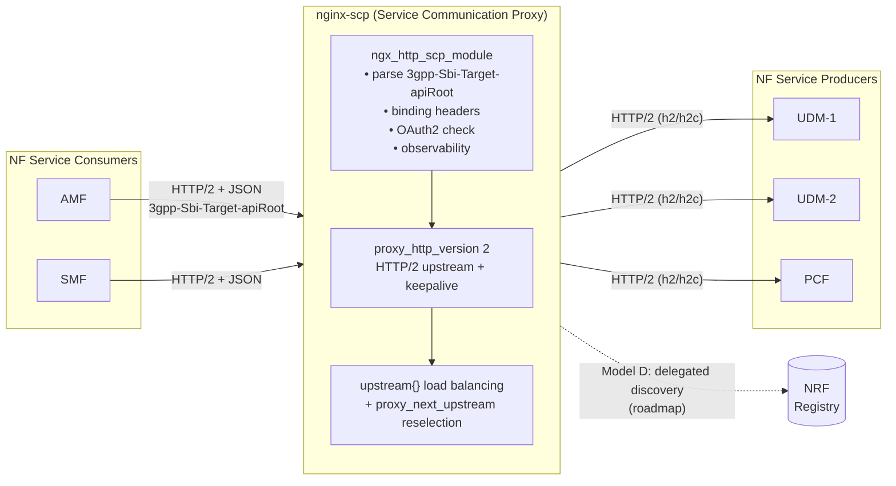
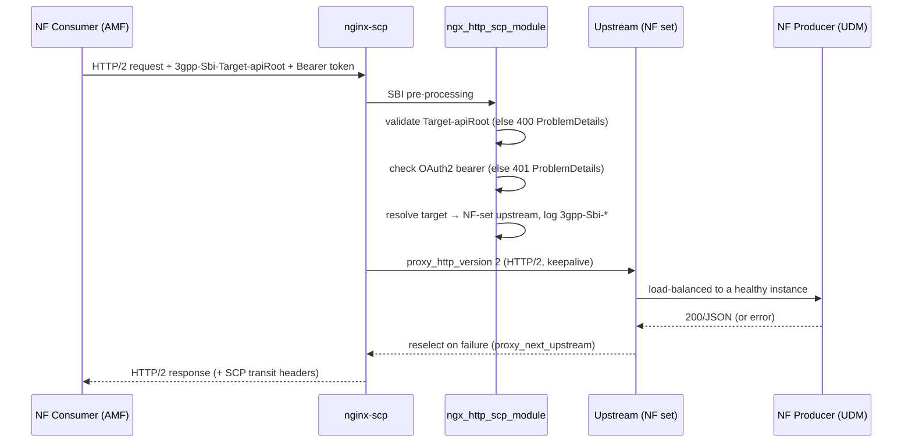

# nginx as a 5G Service Communication Proxy (SCP)

**Hackathon idea write-up — problem, value, and architecture**

> Turn the world's most deployed web server into a standards-aligned 3GPP
> Release‑16 Service Communication Proxy for the 5G Core Service Based
> Interface (SBI).

---

## 1. One-line pitch

The 5G Core routes its internal control-plane traffic over HTTP/2 + JSON, yet
every production SCP today is a bespoke, expensive telco appliance. This nginx
tree now speaks **HTTP/2 end-to-end (downstream *and* upstream)** — the one
capability that was historically missing — so we can build a lightweight,
open, high-performance **Service Communication Proxy on nginx**.

---

## 2. Background: what an SCP is and why it exists

In the 5G Core (5GC), Network Functions (NFs) — AMF, SMF, UDM, PCF, AUSF, NRF,
etc. — no longer talk over point-to-point telecom links. They expose RESTful
**Service Based Interface (SBI)** APIs over **HTTP/2 + JSON** (3GPP TS 29.500 /
29.501), discover each other through the **NRF**, and authorize calls with
**OAuth2** (TS 33.501).

As the number of NFs and micro-services grows, direct N×N communication
becomes an operational nightmare. 3GPP Release 16 introduced the
**Service Communication Proxy (SCP)** (TS 23.501 §6.2.19) as an optional but
central element that provides **indirect communication**:

| Model | Who discovers the producer                       | Who routes |
|-------|--------------------------------------------------|----------- |
| A     | Consumer (direct)                                | Consumer   |
| B     | Consumer (direct)                                | Consumer   |
| **C** | Consumer queries NRF, hands candidate set to SCP | **SCP**    |
| **D** | **SCP** (delegated discovery)                    | **SCP**    |

An SCP delivers:

- **Message routing** based on `3gpp-Sbi-Target-apiRoot` and binding headers
- **Load balancing & NF reselection** across a set of NF instances
- **Delegated discovery** against the NRF (Model D)
- **Overload / congestion control** and retry
- **A single policy, security and observability choke-point** for all SBI
  traffic — mTLS, OAuth2, rate limiting, tracing

In short: the SCP is the **service mesh of the 5G Core control plane**.

---

## 3. Problem statement

Operators and vendors need an SCP, but today's options are poor:

1. **Commercial SCPs are costly and closed.** They ship as monolithic,
   per-vendor appliances with opaque internals and heavy licensing.
2. **DIY on a generic proxy used to hit a wall.** The SBI is **HTTP/2
   end-to-end**. Historically nginx could only *terminate* HTTP/2 from clients
   and only reach upstreams over HTTP/2 through the narrow `grpc_pass` path —
   so a true SBI mediator built on stock nginx was not possible without
   reimplementing the proxy.
3. **Envoy works but is heavy.** Envoy is the usual open choice for 5GC service
   mesh, but it carries a large runtime and operational footprint and a steep
   configuration/filter learning curve.

**There has been no lightweight, open, operationally-familiar SCP foundation.**

---

## 4. The insight — why *now*, why *nginx*

This nginx tree (**nginx 1.31.8**) ships a **native HTTP/2 upstream** for the
standard `proxy_pass`, enabled with a single directive:

```nginx
proxy_http_version 2;   # forward to the NF over HTTP/2, not just gRPC
```

It is implemented by `ngx_http_proxy_v2_module` and provides exactly the SBI
transport primitives an SCP needs:

- **ALPN-negotiated `h2`** to upstreams, plus cleartext **h2c** for internal
  (TLS-meshed) deployments
- A full HTTP/2 **frame state machine** — HEADERS/DATA/SETTINGS/
  WINDOW_UPDATE/RST_STREAM/GOAWAY/PING — with **HPACK**
- Per-stream and per-connection **flow control**
- **Keepalive connection reuse** with correct stream-ID progression

That closes the single biggest gap. Everything else an SCP needs —
header-based routing, load balancing, health checks, TLS, rate limiting —
nginx already does extremely well and at scale.

**Why nginx as the base:**

- **Battle-tested & ubiquitous** — the most widely deployed web server/proxy;
  operators already know how to run it.
- **Tiny footprint, huge throughput** — event-driven C core, minimal memory,
  predictable latency vs. a sidecar-per-pod mesh.
- **Mature TLS edge** — TLS 1.2/1.3, mTLS, OCSP — directly satisfies TS 33.210
  / 33.501 security requirements.
- **Extensible** — a thin custom module can add the SBI-specific Layer-7 logic
  on top of the existing HTTP/2 upstream, rather than rebuilding a proxy.

---

## 5. Proposed solution

**`nginx-scp`** — a 3GPP Release‑16-aligned Service Communication Proxy built
as a thin nginx module layered on the native HTTP/2 upstream.

A small `ngx_http_scp_module` adds SBI awareness in the request path:

- Parse & validate `3gpp-Sbi-Target-apiRoot` (**Model D / indirect** routing)
- Honour `3gpp-Sbi-Routing-Binding` / `3gpp-Sbi-Binding` binding headers
- Enforce / pass through **OAuth2** bearer tokens (TS 33.501)
- Emit structured **observability** for all `3gpp-Sbi-*` headers
- Return proper **`application/problem+json`** ProblemDetails on errors

…and then hands off to nginx's existing machinery for the heavy lifting:
`proxy_http_version 2` for HTTP/2 forwarding, `upstream {}` blocks for NF-set
**load balancing and reselection**, and `proxy_next_upstream` for retry.

### Proof-of-concept scope (follow-on build)

| SBI / SCP capability | How it is demonstrated |
|----------------------|------------------------|
| Model D routing on `3gpp-Sbi-Target-apiRoot` | Consumer sends request to SCP with the header; SCP routes to the right NF set |
| HTTP/2 end-to-end (h2c) | `client → SCP → NF` all over HTTP/2 |
| Load balancing & NF reselection | `upstream{}` block of N NF instances; one killed mid-demo, traffic reselects |
| OAuth2 pass-through / check | Request without a bearer token rejected with `401` ProblemDetails |
| Observability | `3gpp-Sbi-*` headers logged; per-NF request counts |

> Delegated NRF discovery, SEPP/N32 and full overload control are explicitly
> **out of PoC scope** and listed on the roadmap below.

---

## 6. Architecture

### 6.1 Where the SCP sits in the 5G Core



ASCII fallback:

```
   NF Consumers              nginx-scp (SCP)                    NF Producers
 ┌───────────┐      ┌──────────────────────────────┐        ┌────────────┐
 │   AMF     │ h2   │  ngx_http_scp_module          │  h2    │   UDM-1    │
 │   SMF     ├─────►│   • Target-apiRoot routing    ├───────►│   UDM-2    │
 │   ...     │ JSON │   • binding headers           │ h2c/h2 │   PCF ...  │
 └───────────┘      │   • OAuth2 check              │        └────────────┘
                    │   • 3gpp-Sbi-* observability  │
                    │  ──────────────────────────   │        ┌────────────┐
                    │  proxy_http_version 2         │  . . . ►│    NRF     │
                    │  upstream{} LB + reselection  │ (Model  │ (roadmap)  │
                    └──────────────────────────────┘   D)    └────────────┘
```

### 6.2 Request flow (Model D indirect communication)



### 6.3 Mapping to the nginx codebase

| SCP concern | nginx mechanism in this tree |
|-------------|------------------------------|
| HTTP/2 to NFs | `ngx_http_proxy_v2_module` via `proxy_http_version 2` |
| Connection reuse | upstream keepalive (h2 stream-ID progression) |
| TLS / mTLS edge | core SSL (TLS 1.2/1.3, ALPN `h2`) |
| NF-set LB & reselection | `upstream{}` + `proxy_next_upstream` |
| SBI L7 logic (new) | `ngx_http_scp_module` (header parse, OAuth2, ProblemDetails, logging) |

---

## 7. Value proposition

- **Open & vendor-neutral** — breaks the closed-appliance SCP model.
- **Lightweight & fast** — nginx's C core vs. heavyweight meshes; lower cost
  per gbps of SBI traffic.
- **Operationally familiar** — operators already run, monitor and secure nginx.
- **Standards-aligned** — targets TS 23.501 (SCP role), 29.500/29.501 (SBI),
  33.210/33.501 (security).
- **Incremental** — Model D routing first, then discovery, then richer policy;
  each step is independently useful as an SBI gateway even before full SCP.

---

## 8. Competitive landscape

| Option                    | HTTP/2 e2e | Footprint  | Openness | SCP-specific logic |
|--------                   |----------- |----------- |----------|--------------------|
| Commercial SCP            | ✅ | Heavy | ❌ closed  | ✅ full |
| Envoy-based               | ✅ | Heavy | ✅         | via filters/ext-authz |
| Stock nginx (old)         | ❌ upstream| Light      | ✅ | ❌ |
| **nginx-scp (this idea)** | ✅ (`proxy_http_version 2`) | **Light** | ✅ | **thin module** |

---

## 9. Honest risks & limitations

- **Not a full SCP yet.** Delegated NRF discovery, overload control and binding
  reselection semantics are application logic still to be built.
- **Concurrent multiplexing.** The HTTP/2 upstream reuses connections via the
  keepalive pool (one active stream per checked-out connection); true
  many-streams-per-connection concurrency should be benchmarked under load.
- **Not a SEPP.** Inter-PLMN N32 / JOSE protection (PRINS) is a different,
  specialized problem — out of scope.
- **Compliance is a journey.** Interop must be validated against a real NRF and
  the 29.500/29.501/33.501 test cases.

Being explicit about these is part of the pitch: we're proposing a credible
**foundation and trajectory**, not claiming a finished product.

---

## 10. Demo plan & success criteria

**Demo (follow-on PoC):** a Go mock NF cluster + a consumer client send SBI
requests through `nginx-scp`. We show, live:

1. A request with `3gpp-Sbi-Target-apiRoot` routed over **HTTP/2 end-to-end**
   to the correct NF set.
2. **Load balancing** across 2–3 instances; kill one → traffic **reselects**.
3. A missing bearer token → **`401` ProblemDetails**; missing Target-apiRoot →
   **`400` ProblemDetails**.
4. Logs showing the `3gpp-Sbi-*` headers and per-NF request counts.

**Success = all four behaviours demonstrated on commodity hardware with a
single small nginx module and standard `upstream{}` configuration.**

---

## 11. Roadmap beyond the hackathon

1. **Model C** support (consumer-provided candidate set in headers).
2. **Delegated discovery (Model D)** — query the NRF, cache NF profiles, select
   on priority/weight/capacity.
3. **Binding-aware reselection** per TS 29.500 §6.10.
4. **Overload & congestion control**, circuit breaking, retry budgets.
5. **OAuth2 token validation** (not just pass-through) and mTLS to NFs.
6. **OpenTelemetry** tracing across the SBI.

---

## 12. Summary

The SBI's HTTP/2-everywhere requirement used to rule nginx out as an SCP. With
native HTTP/2 upstream now in this tree, that barrier is gone. A **thin module
on top of proven nginx plumbing** turns it into a lightweight, open,
standards-aligned **5G Service Communication Proxy** — starting with Model D
message routing and growing toward full indirect communication.

*Let's build the open SCP the 5G Core has been missing.*

---

## 13. Standards & references

All specifications are 3GPP Release 16. The **ETSI mirror** links give clean,
login-free PDFs — open the folder and pick a version directory starting with
`16.` (e.g. `16.09.00_60`). The **3GPP archive** always carries the latest; its
zip filenames encode the release letter (**Rel‑16 = `g`**, so `29500-gb0.zip`
is 29.500 Rel‑16 v16.11.0; Rel‑15 = `f`, Rel‑17 = `h`).

### Core architecture — what an SCP *is*

| Spec | Scope (SCP-relevant clauses) | Links |
|------|------------------------------|-------|
| **TS 23.501** | 5G System architecture — **SCP defined §6.2.19**, communication models (A/B/C/D) | [3GPP](https://www.3gpp.org/ftp/Specs/archive/23_series/23.501/) · [ETSI](https://www.etsi.org/deliver/etsi_ts/123500_123599/123501/) |
| **TS 23.502** | 5GS procedures (discovery/selection flows the SCP sits in) | [3GPP](https://www.3gpp.org/ftp/Specs/archive/23_series/23.502/) · [ETSI](https://www.etsi.org/deliver/etsi_ts/123500_123599/123502/) |

### SBI stage 3 — how the SCP routes

| Spec | Scope | Links |
|------|-------|-------|
| **TS 29.500** | Technical realization of SBA — **routing §6.10**, `3gpp-Sbi-Target-apiRoot`, `3gpp-Sbi-Routing-Binding` / `3gpp-Sbi-Binding`, SCP behavior, server-side reselection | [3GPP](https://www.3gpp.org/ftp/Specs/archive/29_series/29.500/) · [ETSI](https://www.etsi.org/deliver/etsi_ts/129500_129599/129500/) |
| **TS 29.501** | Principles & guidelines for services definition (OpenAPI, URI structure, apiRoot) | [3GPP](https://www.3gpp.org/ftp/Specs/archive/29_series/29.501/) · [ETSI](https://www.etsi.org/deliver/etsi_ts/129500_129599/129501/) |
| **TS 29.510** | NRF services — `Nnrf_NFManagement` / `Nnrf_NFDiscovery` (needed for **Model D delegated discovery** on the roadmap) | [3GPP](https://www.3gpp.org/ftp/Specs/archive/29_series/29.510/) · [ETSI](https://www.etsi.org/deliver/etsi_ts/129500_129599/129510/) |
| **TS 29.571** | Common data types — **`ProblemDetails`** (the 400/401 error bodies) | [3GPP](https://www.3gpp.org/ftp/Specs/archive/29_series/29.571/) · [ETSI](https://www.etsi.org/deliver/etsi_ts/129500_129599/129571/) |

### Security — TLS, OAuth2, SCP security

| Spec | Scope | Links |
|------|-------|-------|
| **TS 33.501** | 5GS security — **OAuth2 for SBI authorization**, SCP security requirements | [3GPP](https://www.3gpp.org/ftp/Specs/archive/33_series/33.501/) · [ETSI](https://www.etsi.org/deliver/etsi_ts/133500_133599/133501/) |
| **TS 33.210** | Network domain security — TLS profile for SBI transport | [3GPP](https://www.3gpp.org/ftp/Specs/archive/33_series/33.210/) · [ETSI](https://www.etsi.org/deliver/etsi_ts/133200_133299/133210/) |

### Entry points

- **3GPP Portal spec search** (any TS by number, all releases/versions): <https://portal.3gpp.org/>
- **3GPP specifications by series**: <https://www.3gpp.org/specifications-technologies/specifications-by-series>
